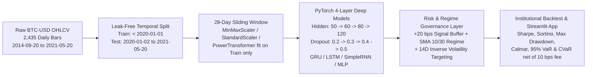

# 📈 `quant-timeseries-risk-forecaster`

**Stack & Links:** Python 3.10+ · [PyTorch](https://github.com/pytorch/pytorch) · [Streamlit](https://github.com/streamlit/streamlit) · [scikit-learn](https://github.com/scikit-learn/scikit-learn) · [License: MIT](LICENSE) · [Business Case & Risk Policy](docs/BUSINESS_CASE_AND_RISK_POLICY.md)

**Deep Learning Financial Risk & Portfolio Backtesting Engine (PyTorch Stacked LSTM/GRU vs. Quantitative Baselines)**  
*Author: **Ali Azizi** (`@NerdNinjaAliaz`) — M.Sc. in Biomedical Engineering ([University of Tehran](https://www.ut.ac.ir/en)) | AI Product Manager*

## 1. Executive Summary & Business Problem

In academic machine learning studies, financial time-series models are typically evaluated solely on point-forecasting error metrics such as Mean Squared Error (MSE) or Root Mean Squared Error (RMSE). However, in quantitative asset management and corporate treasury risk operations, **lower RMSE does not automatically translate into positive risk-adjusted portfolio returns** due to three structural frictions:

1. **Transaction Cost & Turnover Drag**: High-frequency daily signal flipping erodes alpha through exchange fees and bid-ask slippage (modeled here at `10 bps` per trade).
2. **Tail-Risk Exposure**: Unconstrained directional exposure during macro liquidity shocks (such as the March 2020 crypto crash or May 2021 deleveraging) triggers severe drawdowns that breach institutional risk mandates.
3. **Lookahead Data Leakage**: Fitting feature scalers across the entire dataset prior to train/test splitting artificially inflates out-of-sample metrics.

This repository upgrades my earlier academic research on deep recurrent crypto forecasting ([`bitcoin_predictor.ipynb`](https://colab.research.google.com/drive/17t40w1HfbbwlMBRGGUjjsXZ9YtEzZYRf?ouid=114192877993810143807)) into a modular **[PyTorch](https://github.com/pytorch/pytorch)** and **[Streamlit](https://github.com/streamlit/streamlit)** quantitative risk and portfolio backtesting engine.

## 2. System Architecture & Risk Governance Pipeline



## 3. Key Architectural & Commercial Upgrades

| Dimension | Original Academic Study ([`bitcoin_predictor.ipynb`](https://colab.research.google.com/drive/17t40w1HfbbwlMBRGGUjjsXZ9YtEzZYRf?ouid=114192877993810143807)) | Production Risk Engine (`quant-timeseries-risk-forecaster`) |
| :--- | :--- | :--- |
| **Deep Learning Framework** | Monolithic TensorFlow/Keras notebook cells | Modular **[PyTorch](https://github.com/pytorch/pytorch)** (`nn.Module`) classes (`StackedRecurrentForecaster`, `TemporalMLPForecaster`) with gradient clipping (`max_norm=1.0`) |
| **Hidden Layer Architecture** | 4 stacked layers `[50, 60, 80, 120]` + progressive dropout `[0.2, 0.3, 0.4, 0.5]` | Preserves exact `[50, 60, 80, 120]` & `[0.2, 0.3, 0.4, 0.5]` topology across `GRU`, `LSTM`, `SimpleRNN`, and `MLP` ([`src/models.py`](src/models.py)) |
| **Data Hygiene & Scaling** | Risk of test-set leakage when comparing scalers | Strict chronological split (`< 2020-01-01` train, `>= 2020-01-02` test); **[scikit-learn](https://github.com/scikit-learn/scikit-learn)** `MinMaxScaler`, `StandardScaler`, and `PowerTransformer` fit strictly on training data ([`src/data_pipeline.py`](src/data_pipeline.py)) |
| **Position Sizing & Risk Overlay** | None (raw price curve overlay only) | Turnover-buffered regime filter (`+20 bps` threshold + `SMA 10/30` macro trend) + inverse 14-day realized volatility targeting (`65%` annualized vol cap) |
| **Institutional Risk Metrics** | Training/Validation MSE & MAE loss curves | **Sharpe Ratio**, **Sortino Ratio**, **Maximum Drawdown**, **Calmar Ratio**, **95% Daily VaR**, **95% CVaR (Expected Shortfall)**, and net CAGR after `10 bps` transaction fees ([`src/backtest.py`](src/backtest.py)) |
| **Executive Delivery** | Static `matplotlib` plots | Interactive **[Streamlit](https://github.com/streamlit/streamlit)** risk governance dashboard ([`app.py`](app.py)) + automated CLI benchmark runner ([`run_experiment.py`](run_experiment.py)) |

## 4. Out-of-Sample Benchmark Scorecard (`2020-01-02` to `2021-05-20`)

*Dataset: 2,435 daily BTC-USD bars (`2014-09-20` to `2021-05-20`), 28-day lookback window, `$10,000` initial capital, `10 bps` transaction fee/slippage, `2.0%` annual risk-free rate. Full table exported in [`results/benchmark_metrics.csv`](results/benchmark_metrics.csv).*

| Strategy | Cumulative Return (%) | CAGR (%) | Annualized Vol (%) | Sharpe Ratio | Sortino Ratio | Max Drawdown (%) | Calmar Ratio | Daily VaR 95% (%) | Daily CVaR 95% (%) | Win Rate (%) | Total Trades | Forecast RMSE ($) | Forecast MAE ($) |
| :--- | :---: | :---: | :---: | :---: | :---: | :---: | :---: | :---: | :---: | :---: | :---: | :---: | :---: |
| **PyTorch 4-Layer Stacked GRU (Regime + Vol-Targeted)** | **409.29** | **224.32** | 53.92 | **2.42** | **3.90** | -40.06 | 5.60 | -4.26 | -5.23 | 54.84 | 60 | 1,026.50 | 645.49 |
| **PyTorch 4-Layer Stacked LSTM (Regime + Vol-Targeted)** | 335.64 | 189.70 | 54.27 | 2.20 | 3.51 | -39.86 | 4.76 | -4.30 | -5.34 | 54.71 | 58 | **999.88** | **620.98** |
| **PyTorch 4-Layer SimpleRNN (Regime + Vol-Targeted)** | 411.77 | 225.46 | 55.24 | 2.38 | 3.82 | -36.57 | 6.17 | -4.26 | -5.34 | 55.09 | 76 | 1,067.70 | 679.81 |
| **PyTorch Temporal MLP (28D Flattened)** | 449.91 | 242.82 | 55.47 | 2.46 | 3.96 | -39.25 | 6.19 | -4.30 | -5.42 | 55.31 | 79 | 1,191.88 | 723.53 |
| **PyTorch 4-Layer LSTM (Unfiltered Naive Signal)** | 120.54 | 77.12 | 45.87 | 1.43 | 2.29 | -34.54 | 2.23 | -3.79 | -5.16 | 53.74 | 224 | **999.88** | **620.98** |
| **Baseline: Buy & Hold (Passive)** | 483.24 | 257.71 | 61.16 | 2.36 | 3.70 | -45.47 | 5.67 | -4.79 | -6.07 | 54.85 | 1 | — | — |
| **Baseline: SMA 10/30 Crossover** | 566.83 | 294.07 | 52.25 | **2.85** | **4.80** | **-29.97** | **9.81** | -4.21 | -5.11 | 55.76 | 12 | — | — |
| **Baseline: 14D Momentum** | 203.79 | 123.25 | 50.60 | 1.80 | 2.84 | -33.95 | 3.63 | -4.21 | -5.32 | 54.70 | 62 | — | — |

### Core Business & Quantitative Takeaways
* **The "Prediction Error vs. Portfolio Alpha" Paradox**: Although the 4-layer **Stacked LSTM** achieves the lowest point-forecast error (**RMSE `$999.88`**, **MAE `$620.98`**), trading its raw daily directional signal naively results in **224 trades**, dragging net cumulative return down to **120.54%** (**Sharpe `1.43`**).
* **Value of the Risk & Regime Governance Layer**: Adding our turnover-buffered regime filter and 14-day inverse volatility targeting cuts LSTM trade count by **74%** (from `224` to `58` trades) and boosts net cumulative return to **335.64%** (**Sharpe `2.20`**), while the **Stacked GRU** achieves a **Sharpe Ratio of `2.42`** and **Sortino Ratio of `3.90`**, outperforming Passive Buy & Hold (**Sharpe `2.36`**, **Sortino `3.70`**) while cutting annualized volatility from **61.16%** to **53.92%** and reducing Daily 95% CVaR from **`-6.07%`** to **`-5.23%`**.
* **Build vs. Buy Complexity Trade-off**: In persistent single-direction bull trends, a classical **SMA 10/30 Crossover** (`12` trades, **Sharpe `2.85`**) offers zero GPU overhead and minimal fee drag, whereas deep recurrent models (`GRU`/`LSTM`) provide configurable downside tail-risk protection (`VaR`/`CVaR`) and multi-feature extensibility (detailed in [`docs/BUSINESS_CASE_AND_RISK_POLICY.md`](docs/BUSINESS_CASE_AND_RISK_POLICY.md)).

## 5. Repository Structure

```text
quant-timeseries-risk-forecaster/
├── .github/
│   └── workflows/
│       └── ci_benchmark.yml                   # GitHub Actions CI syntax & pipeline verification
├── data/
│   └── BTC-USD.csv                            # 2,435 daily OHLCV bars (2014-09-20 to 2021-05-20)
├── docs/
│   └── BUSINESS_CASE_AND_RISK_POLICY.md       # Institutional risk governance & product management memo
├── results/
│   ├── benchmark_metrics.csv                  # Out-of-sample risk & return scorecard across all 8 strategies
│   └── equity_curves.csv                      # Daily out-of-sample portfolio equity & drawdown series
├── src/
│   ├── __init__.py
│   ├── data_pipeline.py                       # Leak-free temporal split, 28D windowing, multi-scaler support
│   ├── models.py                              # PyTorch 4-layer [50, 60, 80, 120] LSTM, GRU, RNN, and MLP
│   └── backtest.py                            # Vectorized backtester with fee accounting, VaR/CVaR, and Sharpe/Sortino
├── .gitignore                                 # Python, PyTorch, and macOS ignore rules
├── LICENSE                                    # MIT License
├── README.md                                  # Project landing page, architecture, and benchmark scorecard
├── app.py                                     # Interactive Streamlit Executive Risk Dashboard
├── publish_to_github.sh                       # One-command publisher script for @NerdNinjaAliaz
├── requirements.txt                           # Python dependencies (PyTorch, scikit-learn, Streamlit, pandas)
└── run_experiment.py                          # End-to-end CLI training & portfolio backtesting runner
```

## 6. Quickstart & GitHub Publishing Instructions

```bash
# 1. Install dependencies
pip install -r requirements.txt

# 2. Run the full PyTorch training and out-of-sample backtest benchmark via CLI
python3 run_experiment.py --epochs 15 --batch-size 50 --scaler minmax --fee-bps 10

# 3. Launch the interactive Streamlit Executive Risk Dashboard
streamlit run app.py

# 4. Publish directly to GitHub under @NerdNinjaAliaz
bash publish_to_github.sh
```

## 7. Interactive Dashboard Capabilities (`app.py`)

Launching `streamlit run app.py` opens an interactive risk simulation dashboard where portfolio managers and stakeholders can stress-test:
* **Deep Learning Architecture Selection**: Switch live between 4-layer `GRU`, `LSTM`, `SimpleRNN`, and `MLP` models (`[50, 60, 80, 120]` hidden units).
* **Leak-Free Feature Scalers**: Compare **[scikit-learn](https://github.com/scikit-learn/scikit-learn)** `MinMaxScaler`, `StandardScaler`, and `PowerTransformer` fit strictly on pre-2020 training bars.
* **Risk & Friction Controls**: Dynamically adjust transaction fee/slippage (`0–50 bps`), minimum signal edge threshold (`0–100 bps`), progressive dropout (`[0.2, 0.3, 0.4, 0.5]`), and inverse volatility targeting (`65%` annualized cap).
* **Executive Visuals**: Inspect real-time KPI delta cards against Passive Buy & Hold, cumulative `$10,000` equity curves, underwater drawdown profiles, and 1-step-ahead USD price forecasts.

## 8. Author & License

* **Author**: **Ali Azizi** (`@NerdNinjaAliaz`) — M.Sc. in Biomedical Engineering ([University of Tehran](https://www.ut.ac.ir/en)) | AI Product Manager
* **License**: Released under the [MIT License](LICENSE).
